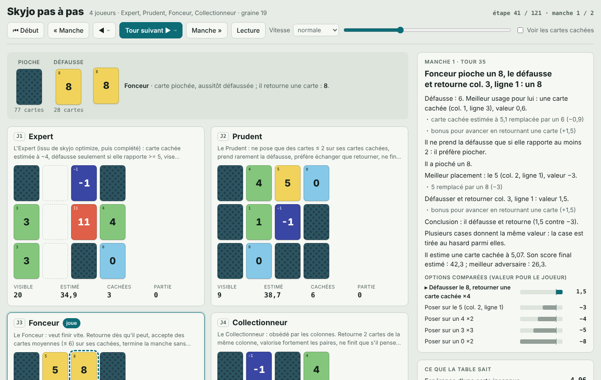
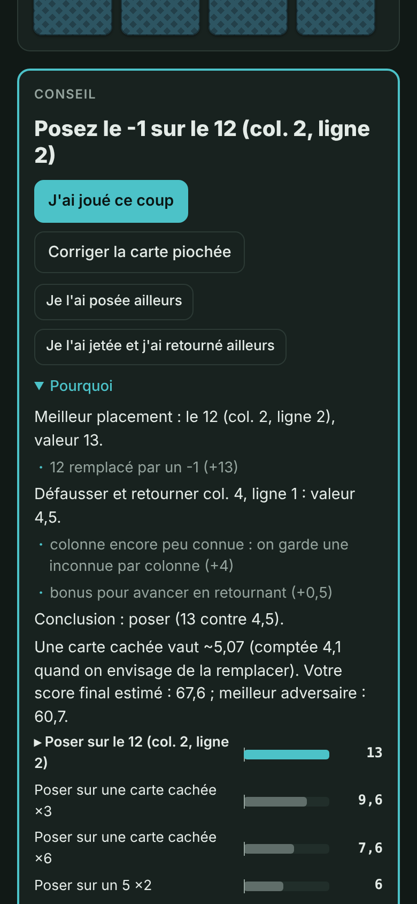
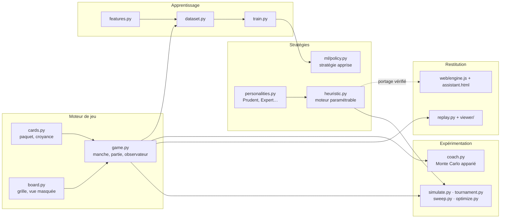

<div align="center">

# skyjo-sim

**Comprendre la meilleure stratégie au Skyjo par la simulation, la statistique et l'apprentissage automatique.**


</div>

> Plus de **1,5 million de parties simulées**, cinq styles de joueurs « humains », un optimiseur de stratégie,
> un coach Monte Carlo, un lecteur de parties expliquées, un assistant utilisable à table sur téléphone et un
> premier modèle d'apprentissage automatique. Toutes les affirmations de ce document sont mesurées, avec leur
> intervalle de confiance.

<table>
<tr>
<td width="62%"></td>
<td width="38%"></td>
</tr>
<tr>
<td><sub><b>skyjo replay</b> — une partie rejouée coup par coup ; à droite, la décomposition chiffrée de la décision.</sub></td>
<td><sub><b>skyjo assistant</b> — à table, on saisit les cartes ; l'Expert dit quoi jouer et pourquoi.</sub></td>
</tr>
</table>

---

## Sommaire

- [Le problème](#le-problème)
- [Résultats](#résultats)
- [Ce qui fait gagner](#ce-qui-fait-gagner)
- [Démarrage rapide](#démarrage-rapide)
- [Architecture](#architecture)
- [Méthodologie](#méthodologie)
- [Apprentissage automatique](#apprentissage-automatique)
- [Qualité logicielle](#qualité-logicielle)
- [Limites et suite](#limites-et-suite)

---

## Le problème

Le Skyjo est un jeu de cartes à information incomplète : chaque joueur a une grille de 12 cartes, face
cachée au départ, et cherche le plus petit total. À chaque tour, il prend la carte visible de la défausse
ou pioche, puis remplace une carte de sa grille ou en retourne une. Trois cartes identiques dans une colonne
disparaissent. Celui qui retourne sa dernière carte termine la manche… et voit son score doublé s'il n'est
pas strictement le plus bas. La partie s'arrête quand un joueur atteint 100 points.

Les questions de départ : **quelle stratégie gagne, à 2, 3 ou 4 joueurs, et pourquoi ?** Les intuitions de
table (« il faut finir vite », « il faut viser les colonnes ») sont-elles justes ?

## Résultats

Tournoi final : toutes les tables possibles entre cinq styles, **3 000 parties par table**, sièges tirés au
sort à chaque partie. L'*indice* est le taux de victoire multiplié par le nombre de joueurs : **1,00 = niveau
du hasard**, ce qui rend comparables des tables de tailles différentes.

| Style | 2 joueurs | 3 joueurs | 4 joueurs | Points / manche (4 j.) |
|---|---|---|---|---|
| **Expert** (optimisé) | **73,9 %** · 1,48 | **56,6 %** · 1,70 | **46,2 %** · 1,85 | **16,5** |
| Stratège (compte les cartes) | 56,4 % · 1,13 | 39,8 % · 1,20 | 29,8 % · 1,19 | 18,5 |
| Prudent | 47,3 % · 0,95 | 29,4 % · 0,88 | 20,8 % · 0,83 | 20,4 |
| Collectionneur | 38,1 % · 0,76 | 23,1 % · 0,69 | 16,1 % · 0,64 | 21,3 |
| Opportuniste | 34,3 % · 0,69 | 17,8 % · 0,53 | 12,2 % · 0,49 | 23,0 |

<sub>Intervalles de confiance à 95 % (Wilson) de ±0,7 à ±0,9 point : tous les écarts du tableau sont significatifs.
Le Fonceur, qui gagne 2 % des parties à 4 joueurs, a été retiré du tournoi final pour ne pas gonfler les autres.</sub>

**Lecture.** L'Expert gagne près d'une partie sur deux à 4 joueurs, presque le double du hasard, et son
avantage *augmente* avec la taille de la table (indice 1,48 → 1,85). Il ne compte pas les cartes : à réglages
identiques, le Stratège qui les compte reste nettement derrière. **Les règles de décision comptent beaucoup
plus que la mémoire.**

Les grandes étapes du projet, chacune mesurée à conditions identiques (mêmes adversaires, mêmes donnes) :

| Étape | Avant | Après | Mesure |
|---|---|---|---|
| Réglage automatique du Prudent (`optimize`) | 24,7 % | **37,4 %** | tournoi à 4 joueurs, 2 000 parties par table |
| Règle « une inconnue par colonne » | 45,2 % | **53,1 %** | table fixe à 4 joueurs, 2 400 parties neuves |
| Réglage final à 4 joueurs | indice 2,06 | **2,17** | 4 tables d'adversaires, graine de validation jamais vue |

## Ce qui fait gagner

Chaque règle a été testée **seule**, adversaires et donnes fixés, sur 3 000 parties ou plus.

| # | Règle | Effet mesuré |
|---|---|---|
| 1 | **Garder une inconnue par colonne** : révéler d'abord les colonnes encore cachées | 45,2 % → **53,1 %** de victoires, +24 % de colonnes complétées. Contrôle : un simple bonus de retournement de même force ne donne rien (46,2 %) |
| 2 | **Ignorer le rythme des autres** : ne pas accélérer en tête ni ralentir derrière | Stratège 29,0 % → **37,8 %** |
| 3 | **Viser les paires** (une paire vaut ~4 points d'espoir) | Sans ce bonus, l'indice chute de 1,56 à 1,14 |
| 4 | **Défausse seulement si elle rapporte ≥ 5 points** ; sinon piocher, qui garde l'option de jeter | Seuil 2 → 4 : 25,9 % → 30,1 % |
| 5 | **Poser jusqu'à 4 sur une carte cachée** (elle vaut ~5, moins sa valeur d'option) | « toute carte sous 5 » → seuil 4 : 29,0 % → 33,4 % ; seuil 0 : 20,2 % |
| 6 | **Retourner sans hésiter** | Éviter de retourner : 34,1 % → 30,1 % |
| 7 | **Ne finir qu'avec ~10 points d'avance estimée** | Doublement du finisseur 27 % → 12 % |

**Fausses bonnes idées, mesurées** : retourner deux cartes de la même colonne au départ (aucun effet),
privilégier les paires de cartes hautes (−4,5 points de victoire), éviter de servir le joueur suivant
(nuisible), finir le plus vite possible (2 % de victoires à 4 joueurs).

## Démarrage rapide

```bash
git clone <ce dépôt> && cd skyjo-sim
python -m venv .venv && source .venv/bin/activate     # Windows : .venv\Scripts\Activate.ps1
pip install -e ".[dev]"
pytest -q
```

| Commande | Ce qu'elle produit |
|---|---|
| `skyjo list` | Les stratégies disponibles et leur description |
| `skyjo tournament --players 2 3 4 --games 3000` | Classement par taille de table, toutes les tables possibles |
| `skyjo match --strategies expert,prudent,fonceur --games 5000 --log-games 1000` | Une table précise + journal de chaque décision |
| `skyjo sweep --base expert --param finish_margin --values 0 5 10 20 --opponents prudent,collectionneur` | Effet d'un réglage, toutes choses égales par ailleurs |
| `skyjo optimize --base expert --players 4` | Réglage complet d'un profil, validé sur des parties neuves |
| `skyjo coach --me "5 ? ? 3 / ? 12 ? ? / 0 ? ? ?" --opp "? 4 ? ? / ? ? ? 1 / ? ? 2 ?" --discard 7 --drawn 9` | Meilleur coup dans une situation, par simulation |
| `skyjo replay --strategies expert,prudent,fonceur,collectionneur --seed 19` | Partie rejouable dans le navigateur, chaque coup justifié |
| `skyjo assistant` | Page autonome pour jouer une vraie partie avec les conseils de l'Expert |
| `skyjo ml dataset` · `skyjo ml train` · `skyjo ml eval` | Pipeline d'apprentissage automatique |

Toutes les commandes de simulation sont parallélisées (`--jobs`), reproductibles (`--seed` : mêmes résultats quel
que soit le nombre de processus) et affichent une barre de progression avec temps restant.

## Architecture



```
src/skyjo/
├── cards.py · board.py · rules.py · game.py   moteur (règles officielles, variantes paramétrables)
├── strategies/                                interface, moteur heuristique, personnalités
├── simulate.py · tournament.py · sweep.py     simulation parallèle, agrégats, intervalles de confiance
├── optimize.py                                descente de coordonnées multi-terrains + validation
├── coach.py                                   meilleur coup par Monte Carlo à nombres aléatoires communs
├── analysis.py                                analyse des journaux de décisions (pandas)
├── replay.py · viewer/                        enregistrement d'une partie expliquée → HTML autonome
├── assist.py · web/                           assistant en direct (moteur JS + page téléphone)
├── ml/                                        caractéristiques, données, entraînement, stratégie apprise
└── progress.py · report.py                    barre de progression, sorties console et CSV
tests/                                         règles, simulation, coach, optimisation, replay, ML, parité JS
```

**Principes de conception.**
- **Une stratégie ne voit jamais une carte cachée** : elle reçoit une vue en lecture seule (`BoardView`) qui
  lève une erreur si on lit une carte face cachée. Les tests le vérifient.
- **Un seul moteur de décision, paramétré.** Chaque personnalité est un jeu de 17 paramètres (`Profile`) ; tout
  réglage se surcharge en ligne de commande : `expert:finish_margin=5:reveal_spread=2`.
- **Le moteur de jeu ignore ses observateurs.** Le journal, le replay et le jeu de données ML se branchent sur un
  observateur d'événements ; sans observateur, aucun coût.
- **Le cœur n'a aucune dépendance.** pandas, scikit-learn et pyarrow ne sont requis que pour l'analyse et le ML.

## Méthodologie

| Problème | Réponse |
|---|---|
| Comparer des tables de tailles différentes | Indice de victoire = taux × nombre de joueurs (1,00 = hasard) |
| Biais de position (premier joueur…) | Sièges tirés au sort à chaque partie |
| Savoir si un écart est réel | Intervalles de Wilson à 95 % sur les taux, IC sur les points par manche |
| Réduire la variance des comparaisons | Nombres aléatoires communs : chaque variante joue les mêmes donnes |
| Éviter le sur-apprentissage de l'optimiseur | Optimisation sur plusieurs tables d'adversaires, puis **revalidation sur une graine jamais vue** ; un gain qui disparaît est déclaré bruit |
| Attribuer un effet à la bonne cause | Expériences de contrôle (ex. « une inconnue par colonne » contre un bonus de retournement de même force) |
| Corrélation ≠ causalité dans les journaux | Le coach mesure l'effet d'un coup en rejouant la même situation avec chaque coup possible |
| Explications fidèles au code | Le mode explication ne modifie aucune décision : une partie rejouée est identique à une partie simulée (testé) |
| Deux implémentations du même moteur | Le moteur JavaScript de l'assistant est comparé au moteur Python sur des centaines de situations aléatoires (≈ 19 000 vérifications, tolérance 1e-9) ; un test de mutation prouve que le contrôle détecte une erreur volontaire |

Les règles implémentées sont celles du livret officiel (colonnes retirées y compris au retournement final,
doublement des seuls scores positifs, premier joueur de la manche suivante = celui qui a fini). Les points non
précisés par le livret sont des options (`--no-columns-on-reveal`, `--no-columns-at-final-reveal`).

## Apprentissage automatique

**Objectif** : trouver des régularités que l'œil humain et l'optimiseur de paramètres n'ont pas vues, puis
battre l'Expert. Critère de succès unique et mesurable : un taux de victoire supérieur à l'Expert en
face-à-face, avec un intervalle de confiance qui exclut l'égalité.

**Approche : une fonction de valeur sur les après-coups** (*afterstates*, comme TD-Gammon). Pour chaque coup
possible, on construit la situation juste après le coup (ma grille, le contexte public) et un modèle prédit
mon score final de manche, doublement compris. La stratégie apprise joue le coup au plus petit score prédit ;
pour un retournement, la prédiction est moyennée sur les valeurs que la carte cachée peut prendre. C'est une
étape d'**itération de politique approchée**, répétable : générer des parties avec la nouvelle stratégie,
réentraîner, recommencer.

```bash
pip install -e ".[ml]"
skyjo ml dataset --games 20000 --seed 1      # parties simulées → une ligne par coup (24 caractéristiques)
skyjo ml train                               # modèle + métriques + importances → models/value.json
skyjo ml eval --games 2000 --seed 2          # le modèle contre l'Expert, à 2, 3 et 4 joueurs
skyjo tournament --pool expert,ml,stratege,prudent --players 2 3 4
```

**Garde-fous.** Données : tables mélangeant toutes les personnalités, avec 10 % de coups au hasard
(exploration) pour couvrir aussi les situations que les bons joueurs évitent. Uniquement de l'information
publique. Découpage entraînement/test **par partie** (aucune fuite entre coups d'une même manche). Deux
références obligatoires : l'estimation naïve de l'Expert et une régression linéaire.

**Premiers résultats** (4 000 parties, 624 285 coups ; test sur 123 832 coups de parties jamais vues) :

| Modèle | Erreur absolue moyenne | R² |
|---|---|---|
| Estimation naïve (visibles + cachées × 5,07) | 18,47 | −1,45 |
| Régression linéaire | 9,91 | 0,20 |
| **Gradient boosting** (120 arbres, 31 feuilles) | **9,56** | **0,25** |

Le R² modeste est attendu : le score final dépend surtout des cartes qui seront piochées. Ce qui compte est
que le *classement* des coups soit bon. Variables les plus utilisées (importance par permutation) : score
visible, score estimé, **nombre de cartes cachées de l'adversaire le plus avancé**, plus haute carte visible,
avance estimée, finir la manche avec ce coup.

**La stratégie apprise contre l'Expert** (300 à 400 parties par table) :

| Données d'entraînement | 2 joueurs : ML contre Expert | 4 joueurs : ML · Expert · Prudent · Collectionneur |
|---|---|---|
| Mélange de styles + 10 % d'exploration (4 000 parties) | 39,8 % · **60,2 %** | **39,0 %** · **39,8 %** · 12,2 % · 9,0 % |
| Expert seul + 10 % d'exploration (3 000 parties) | 36,5 % · **63,5 %** | 37,4 % · **43,1 %** · 10,6 % · 8,9 % |

**Lecture honnête.**
- Sans aucune règle écrite à la main, la stratégie apprise écrase le Prudent et le Collectionneur et fait
  **jeu égal avec l'Expert à 4 joueurs**. À 2 joueurs, elle perd nettement.
- Apprendre sur les seules parties de l'Expert (pour l'améliorer coup par coup, comme le voudrait la théorie de
  l'itération de politique) **n'aide pas**.
- **Plus de données n'y changera rien** : courbe d'apprentissage à plat dès 2 000 parties (erreur 9,51 → 9,56).
  Le goulot est la formulation : le score final dépend surtout des pioches à venir, et l'écart entre deux coups
  candidats (1 à 3 points) se noie dans ce bruit.

**Prochaine itération, par ordre de priorité** :
1. **Étiquettes à faible variance** : pour des situations tirées des parties, le coach (Monte Carlo à nombres
   aléatoires communs) mesure la valeur de chaque coup ; on apprend alors directement à *classer* les coups
   (itération d'expert, à la manière d'AlphaZero sans réseau).
2. **Apprentissage par différence temporelle** : viser la valeur prédite de l'après-coup suivant plutôt que le score
   final, nettement moins bruité.
3. **Cible relative** : mon score moins celui du meilleur adversaire, plus proche de ce qui fait gagner.

## Qualité logicielle

- **Tests** : règles (doublement, colonnes, ordre des manches), invariance des résultats au parallélisme,
  reproductibilité, coach, optimiseur, replay (identité avec la simulation), pipeline ML de bout en bout, parité
  Python ↔ JavaScript avec test de mutation.
- **CI GitHub Actions** : Python 3.10 et 3.12, Node 20, `ruff` puis `pytest`.
- **Performance** : profilage à chaque étape (×2,4 sur le moteur à résultats strictement identiques ; regroupement
  des appels au modèle ML : ×3 ; sursouscription OpenMP détectée et corrigée : ×40 en parallèle, test de
  non-régression dédié).
- **Reproductibilité** : chaque commande accepte `--seed` ; les sorties (CSV, modèles, rapports JSON) ne sont pas
  versionnées et se régénèrent.

## Limites et suite

- Les adversaires sont des stratégies programmées : les conclusions valent face à ces styles, pas face à tout
  joueur humain. L'assistant permet justement de confronter les conseils à de vraies parties.
- L'Expert ne tient pas compte du score cumulé de la partie (finir plus volontiers quand un adversaire approche 100).
- Pistes ML : seconde itération de politique (données générées par la stratégie apprise), cible relative (mon score
  moins le meilleur adversaire), caractéristiques par colonne, explications locales (SHAP), puis apprentissage par
  renforcement si la fonction de valeur montre qu'il reste des points à gagner.
